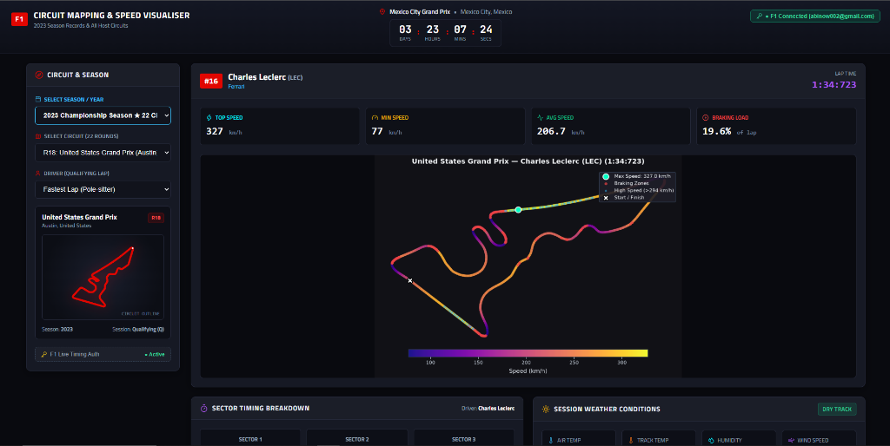
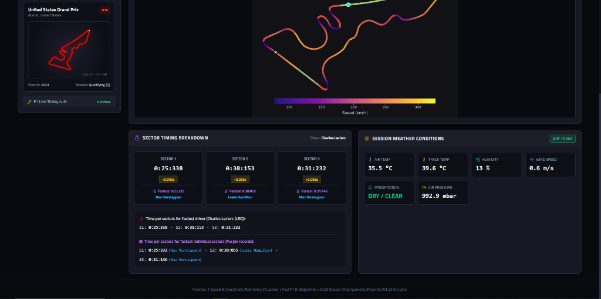

# 🏎️ Formula 1 Circuit Mapping & Speed Telemetry Visualiser

[](https://github.com/theOehrly/Fast-F1)
[](https://fastapi.tiangolo.com/)
[](https://react.dev/)
[](https://vitejs.dev/)
[](https://www.python.org/)
[](https://opensource.org/licenses/MIT)

An interactive, high-performance Formula 1 telemetry analytics platform that reconstructs qualifying laps using authentic car GPS positional coordinates, generates continuous speed heatmaps with Matplotlib `LineCollection`, analyzes micro-sector splits, and tracks live session weather conditions across all 78 championship circuits in Formula 1 history.

**Live Demo:** [https://f1-telemetry-ak.vercel.app/](https://f1-telemetry-ak.vercel.app/)

[](https://f1-telemetry-ak.vercel.app/)
[](https://f1-telemetry-ak.vercel.app/)

---

## 📸 Key Features

* **🏎️ GPS Positional Circuit Mapping**: Reconstructs qualifying laps using high-precision telemetry coordinates $(X, Y)$ sampled along the circuit length.
* **🔥 Continuous Speed Heatmap**: Utilizes Matplotlib's `LineCollection` with normalized colormaps (`plasma`) to show real-time velocity transitions, high-speed straights ($> 330\text{ km/h}$), apex speeds, and heavy braking zones.
* **🗺️ 78 Authentic Grand Prix Circuit Maps**: Features official vector outlines for all 78 circuits that have hosted a World Championship Grand Prix (Monaco, Monza, Spa-Francorchamps, Silverstone, Suzuka's figure-eight, Las Vegas Strip, Circuit of the Americas, etc.) complete with start/finish line markers.
* **⏱️ Sector Timing Breakdown & Record Holders**:
  * Individual sector timings ($S_1, S_2, S_3$) formatted in clean colon notation (e.g. `0:31:204`).
  * Displays the **driver name who holds the fastest record** for each sector.
  * Driver deltas compared against the theoretical session-best purple sectors.
* **⛅ Meteorological Telemetry**: Real-time atmospheric air temperature, track surface temperature, atmospheric pressure, relative humidity, wind velocity vectors, and wet/dry track indicators.
* **⏳ Next Grand Prix Live Countdown**: Real-time ticking countdown to the next Formula 1 event with country flag and venue details.
* **📅 Historical Seasons (2018–2024)**: Official **2023 Championship Season** pre-loaded with all 22 official Grand Prix rounds and authentic pole lap benchmarks.
* **🔐 Formula 1 Entry Gateway & Live API Authentication**:
  * **Interactive Gateway on Site Entry**: Automatic connection portal welcoming visitors to connect their official Formula 1 credentials.
  * **Direct IDP Token Exchange**: Securely authenticates via `https://id.formula1.com/as/token` and provisions FastF1's `token_manager` for live session telemetry streaming.
  * **Guest / 2023 Archive Mode**: Instant one-click exploration mode allowing access to all 22 official rounds without requiring immediate sign-in.
  * **Session Management**: Live status badge in the header and one-click disconnect.

---

## 🏛️ System Architecture

```text
┌────────────────────────────────────────────────────────┐
│                      DATA SOURCES                      │
│   FastF1 API (Live Timing, Car GPS, Weather, Laps)     │
│   Formula 1 IDP (id.formula1.com Authentication)       │
└──────────────────────────┬─────────────────────────────┘
                           │
                           ▼
┌────────────────────────────────────────────────────────┐
│                   BACKEND ENGINE                       │
│  FastAPI (Python 3.10+)                                │
│  ├── Auth & Token Manager (fastf1.internals.f1account) │
│  ├── Local Disk Cache (fastf1.Cache)                   │
│  ├── Telemetry & GPS Processing Engine (Pandas, NumPy) │
│  ├── Speed Visualizer (Matplotlib LineCollection)      │
│  └── REST API Endpoints (/api/v1/...)                  │
└──────────────────────────┬─────────────────────────────┘
                           │ JSON Telemetry + SVG Maps + Data URIs
                           ▼
┌────────────────────────────────────────────────────────┐
│                  FRONTEND CLIENT                       │
│  React 18 + Vite (Responsive Dark F1 Theme)            │
│  ├── Entry: F1 API Connection Gateway Modal            │
│  ├── Header: Live Countdown Banner & Auth Status Pill  │
│  ├── Left: Season Dropdown, Circuit Selector & Outline │
│  └── Right: Speed Heatmap, Sector Splits & Weather     │
└────────────────────────────────────────────────────────┘
```

---

## 📁 Repository Structure

```text
├── backend/
│   ├── app/
│   │   ├── api/v1/
│   │   │   ├── endpoints.py         # REST route definitions (telemetry & auth)
│   │   │   └── schemas.py           # Pydantic v2 schemas for telemetry & auth
│   │   ├── core/
│   │   │   └── config.py            # Settings, paths, and CORS configuration
│   │   ├── services/
│   │   │   ├── f1_service.py        # FastF1 data loading, auth & 2023 records
│   │   │   └── visualizer.py        # Matplotlib LineCollection speed heatmap
│   │   └── main.py                  # FastAPI application entrypoint
│   └── requirements.txt             # Python dependencies
│
├── frontend/
│   ├── public/
│   │   └── track_svgs/              # 78 authentic F1 circuit SVG maps
│   ├── src/
│   │   ├── components/
│   │   │   ├── AuthModal.jsx        # Formula 1 API authentication gateway
│   │   │   ├── CircuitSelector.jsx  # Season, circuit & driver selection
│   │   │   ├── CountdownBanner.jsx  # Live next-race countdown banner
│   │   │   ├── SectorComparison.jsx # S1/S2/S3 splits & record holders
│   │   │   ├── TelemetryViewer.jsx  # Driver stats & speed heatmap display
│   │   │   └── WeatherCard.jsx      # Meteorological & track condition cards
│   │   ├── services/
│   │   │   └── api.js               # Axios / Fetch REST API client
│   │   ├── utils/
│   │   │   └── trackSvgMapper.js    # Circuit-to-SVG mapper for all 78 tracks
│   │   ├── App.jsx                  # Main dashboard layout & entry auth trigger
│   │   ├── index.css                # F1 Racing UI styles & responsive grid
│   │   └── main.jsx                 # React root DOM mounting
│   └── package.json                 # Frontend dependencies & Vite configuration
│
├── scripts/
│   ├── download_all_authentic_svgs.py # Vector downloader for all 78 circuits
│   ├── verify_backend_api.py          # API automated test suite
│   ├── test_auth_endpoints.py         # F1 authentication verification
│   └── test_svg_mapper.mjs            # Track SVG mapping verification
│
├── .gitignore                       # Clean Git configuration
└── README.md                        # Documentation
```

---

## 🚀 Quick Start Guide

### 1. Prerequisites
* **Python**: 3.10 or higher
* **Node.js**: v18 or higher (with npm)
* **Git**

### 2. Clone the Repository
```bash
git clone https://github.com/Abi26510/F1-telemetry.git
cd F1-telemetry
```

### 3. Backend Setup
```bash
# Optional: Create and activate virtual environment
python -m venv venv
# On Windows:
.\venv\Scripts\activate
# On Linux/macOS:
source venv/bin/activate

# Install backend dependencies
pip install -r backend/requirements.txt

# Start the FastAPI backend server
uvicorn backend.app.main:app --host 127.0.0.1 --port 8000 --reload
```
* Backend API will be live at: `http://127.0.0.1:8000`
* Interactive Swagger Docs: `http://127.0.0.1:8000/docs`

### 4. Frontend Setup
In a new terminal window:
```bash
cd frontend

# Install frontend dependencies
npm install

# Start the Vite development server
npm run dev
```
* Open your browser at: `http://localhost:3000`

---

## 🌐 Production Deployment (Render + Vercel)

### 1. Backend on Render (Web Service)
1. In [Render Dashboard](https://dashboard.render.com/), click **New +** → **Web Service** and connect this repository.
2. Configure settings:
   * **Name**: `f1-telemetry-backend`
   * **Environment**: `Python 3`
   * **Root Directory**: Leave blank (repository root)
   * **Build Command**: `pip install -r backend/requirements.txt`
   * **Start Command**: `uvicorn backend.app.main:app --host 0.0.0.0 --port $PORT`
3. Click **Deploy Web Service** and copy your service URL (e.g. `https://f1-telemetry-api.onrender.com`).

### 2. Frontend on Vercel
1. In [Vercel Dashboard](https://vercel.com/dashboard), click **Add New...** → **Project** and import this repository.
2. Configure settings:
   * **Framework Preset**: `Vite`
   * **Root Directory**: `frontend`
   * **Build Command**: `npm run build`
   * **Output Directory**: `dist`
3. Expand **Environment Variables** and add:
   * **Key**: `VITE_API_BASE_URL`
   * **Value**: `https://your-backend.onrender.com/api/v1` *(Note: `https://your-backend.onrender.com` without `/api/v1` or with a trailing slash is also automatically handled)*
4. Click **Deploy**.

---

## 📡 API Reference

| Endpoint | Method | Description |
| :--- | :---: | :--- |
| `/api/v1/auth/login` | `POST` | Authenticate with Formula 1 credentials to unlock live telemetry access. |
| `/api/v1/auth/logout` | `POST` | Clear cached F1 tokens and disconnect session. |
| `/api/v1/auth/status` | `GET` | Check current Formula 1 account connection status. |
| `/api/v1/years` | `GET` | List available championship seasons (2018–2024). |
| `/api/v1/circuits?year=2023` | `GET` | List all circuits for the requested season (22 rounds for 2023). |
| `/api/v1/telemetry/speed-map` | `GET` | Fetch lap telemetry, speed heatmap, sector splits, and weather. |
| `/api/v1/calendar/next-race` | `GET` | Upcoming Grand Prix details and countdown timestamp. |
| `/health` | `GET` | API health check endpoint. |

### 🔐 Authentication Request Example
```json
POST /api/v1/auth/login
Content-Type: application/json

{
  "username": "your_email@example.com",
  "password": "your_password"
}
```

### Telemetry Request Parameters
```text
GET /api/v1/telemetry/speed-map?year=2023&gp=1&driver=VER&session_type=Q
```
* `year`: Season year (e.g. `2023`)
* `gp`: Round number or circuit name (e.g. `1` or `Bahrain`)
* `driver`: Driver abbreviation (e.g. `VER`, `HAM`, `LEC`, `PER`, or empty for pole-sitter)
* `session_type`: Session code (`Q` for Qualifying, `R` for Race, `FP1`, `FP2`, `FP3`)

---

## 🧪 Testing & Verification

Automated test scripts are included in `scripts/`:

```bash
# Verify backend API endpoints and 2023 data
python scripts/verify_backend_api.py

# Verify F1 authentication login/logout flow
python scripts/test_auth_endpoints.py

# Verify SVG mapping across all 78 circuits
node scripts/test_svg_mapper.mjs

# Build frontend production bundle
cd frontend && npm run build
```

---

## 🛠️ Built With

* **[FastF1](https://github.com/theOehrly/Fast-F1)** - Official Formula 1 timing and telemetry data wrapper.
* **[FastAPI](https://fastapi.tiangolo.com/)** - High-performance Python async web framework.
* **[Matplotlib](https://matplotlib.org/)** - Scientific plotting and `LineCollection` color-mapped track rendering.
* **[React](https://react.dev/)** & **[Vite](https://vitejs.dev/)** - Frontend UI library and lightning-fast build tool.
* **[Lucide React](https://lucide.dev/)** - High-clarity dashboard icons.
* **[f1-circuits-svg](https://github.com/MisterSix2295/f1-circuits-svg)** - Official Grand Prix circuit vector layouts.

---

## 📄 License

Distributed under the **MIT License**.

---

## 🏁 Acknowledgements & Disclaimer

* Data provided by **Formula 1** through the **FastF1** Python package.
* This is an unofficial, community-developed analytics and educational platform. Formula 1 and F1 are registered trademarks of Formula One Licensing B.V.
